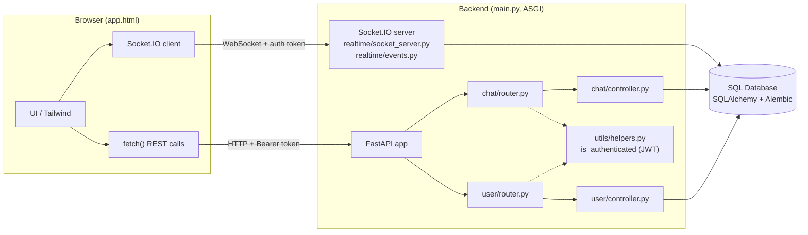
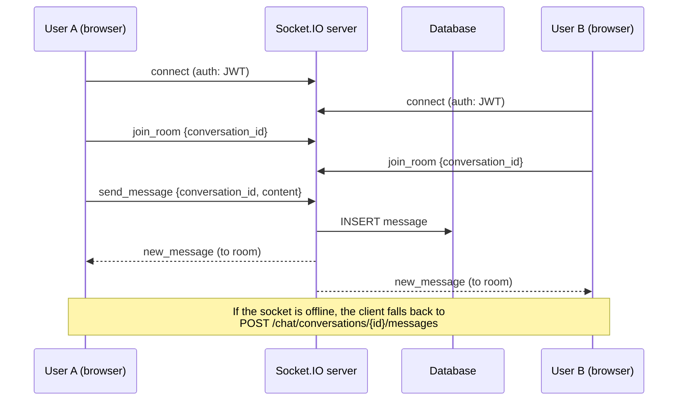
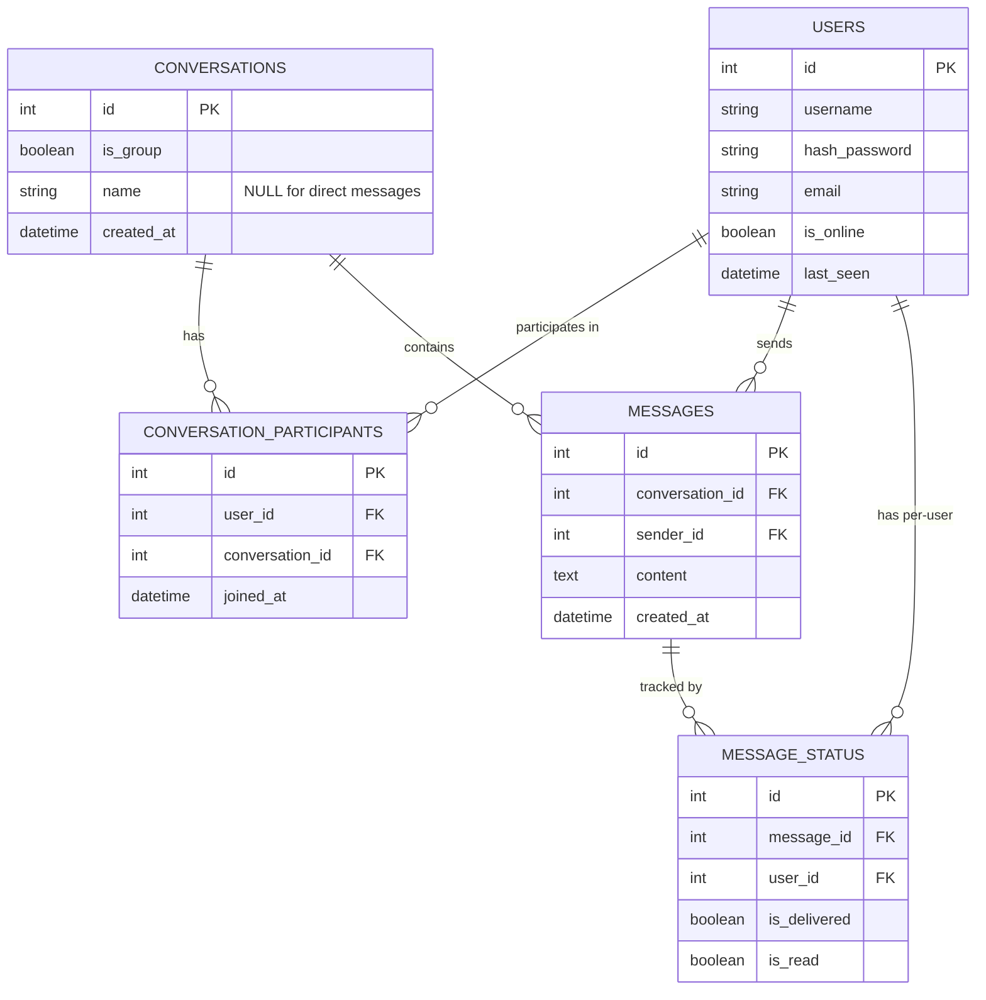
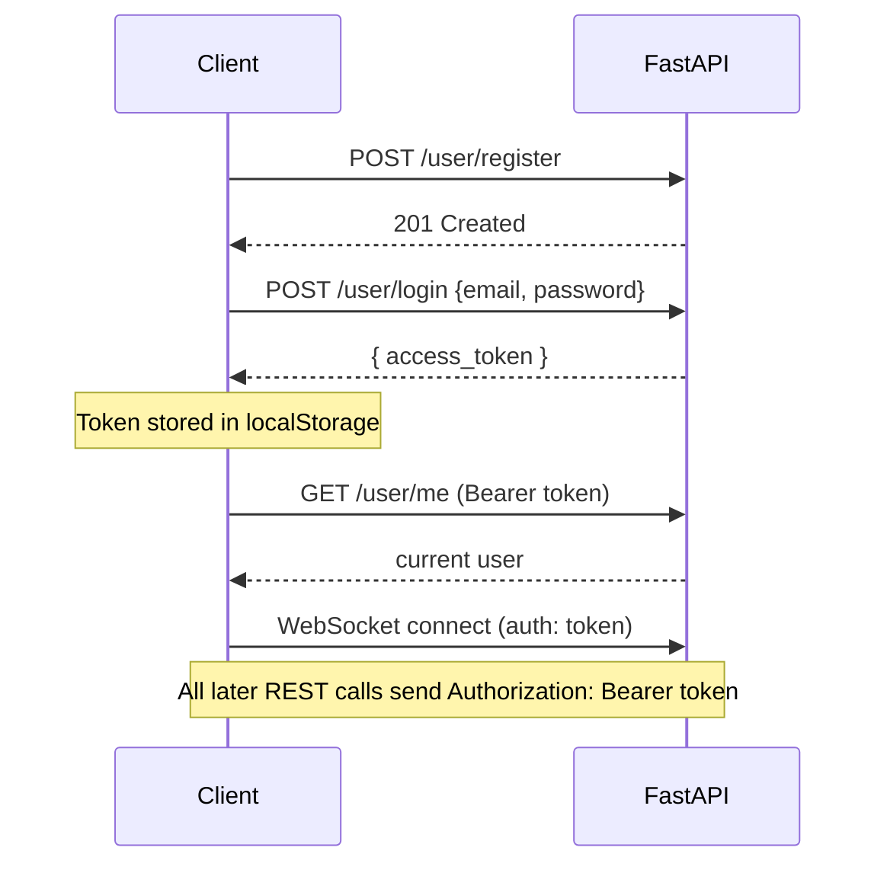

# NexusChat — Real-Time Chat Application

A full-stack real-time messaging application with **1-on-1 direct messages** and **group conversations**. The backend is built with **FastAPI**, **SQLAlchemy** and **Socket.IO**; the frontend is a single-file, terminal-themed web client built with **Tailwind CSS** and vanilla JavaScript.

---

## Table of Contents

1. [Features](#features)
2. [Tech Stack](#tech-stack)
3. [Architecture](#architecture)
4. [Project Structure](#project-structure)
5. [Database Design](#database-design)
6. [API Reference](#api-reference)
7. [Real-Time Events (Socket.IO)](#real-time-events-socketio)
8. [Getting Started](#getting-started)
9. [Configuration](#configuration)
10. [Frontend Client](#frontend-client)
11. [Authentication Flow](#authentication-flow)
12. [Known Limitations & Roadmap](#known-limitations--roadmap)
13. [Troubleshooting](#troubleshooting)

---

## Features

**Accounts & Auth**
- User registration and login with hashed passwords
- JWT bearer-token authentication for both REST and WebSocket connections
- Session restore on page reload; clean logout with full state reset
- User search by name/email

**Conversations**
- Direct (1-on-1) conversations and named group conversations
- Create a conversation with multiple participants at once
- Add members to a group, remove members, or leave a conversation
- Rename a group
- Membership checks on every read/write (only participants can access a conversation)

**Messaging**
- Real-time message delivery over Socket.IO rooms
- Persistent message history in the database
- REST fallback when the socket is offline
- Per-message delivery/read status tracking (`message_status` table)
- Mark-as-read and in-conversation message search endpoints

**Client UI**
- Dark, terminal-style interface
- Sidebar with conversation search; direct chats display the other person's name
- Channel management modal with member list, rename, enroll and remove
- Live connection indicator and toast notifications
- Readable server error messages (including FastAPI validation errors)

---

## Tech Stack

| Layer | Technology |
|---|---|
| API framework | FastAPI |
| Real-time | python-socketio (ASGI), Socket.IO JS client |
| ORM | SQLAlchemy |
| Migrations | Alembic |
| Auth | JWT (PyJWT) |
| Email | Background tasks via `utils/mail.py` (registration mail) |
| Containers | Docker Compose |
| Frontend | HTML, Tailwind CSS (CDN), vanilla JS, Lucide icons |

---

## Architecture



`main.py` wraps the FastAPI app in a `socketio.ASGIApp`, so a **single process and a single port** serve both the REST API and the WebSocket endpoint.

### Message flow



---

## Project Structure

```text
real time chat application/
├── main.py                    # App entrypoint: FastAPI + Socket.IO ASGI wrapper
├── alembic.ini                # Alembic configuration
├── docker-compose.yml         # Container services
├── requirement.txt            # Python dependencies
├── .env                       # Environment variables (not committed)
├── migrations/                # Alembic migration scripts
└── src/
    ├── chat/
    │   ├── controller.py      # Conversation / message business logic
    │   ├── dtos.py            # Pydantic request schemas
    │   ├── models.py          # Conversation, ConversationParticipant, Message, MessageStatus
    │   └── router.py          # /chat/* endpoints
    ├── realtime/
    │   ├── socket_server.py   # Socket.IO server instance + ASGI app
    │   └── events.py          # connect / join_room / send_message handlers
    ├── user/
    │   ├── controller.py      # Register, login, search
    │   ├── dtos.py            # UserCreate, LoginSchema, UserResponseSchema
    │   ├── models.py          # UserModel
    │   └── router.py          # /user/* endpoints
    └── utils/
        ├── constant.py
        ├── db.py              # Engine, Base, get_db dependency
        ├── helpers.py         # is_authenticated dependency (JWT)
        ├── mail.py            # Email sending
        └── settings.py        # Environment-based settings
```

The code follows a simple layered pattern: **router → controller → models**. Routers handle HTTP concerns and dependency injection, controllers hold the business rules and authorization checks, and models define the schema.

---

## Database Design

### Entity-Relationship Diagram



`conversation_participants` is the **junction table** that resolves the many-to-many relationship between users and conversations. `message_status` stores **one row per (message, recipient)** so delivery and read state can be tracked independently for each user, which is what group chats need.

### Table: `users`

| Column | Type | Constraints | Description |
|---|---|---|---|
| `id` | Integer | PK | Unique user ID |
| `username` | String | NOT NULL | Display name |
| `hash_password` | String | NOT NULL | Hashed password (never store plain text) |
| `email` | String | | Email address used to sign in |
| `is_online` | Boolean | NOT NULL, default `false` | Presence flag |
| `last_seen` | DateTime (tz) | default `now()` | Last activity timestamp |

**Relationships:** `participations` → ConversationParticipant · `messages` → Message · `message_statuses` → MessageStatus

### Table: `conversations`

| Column | Type | Constraints | Description |
|---|---|---|---|
| `id` | Integer | PK, indexed | Conversation ID |
| `is_group` | Boolean | default `false` | `false` = direct message, `true` = group |
| `name` | String | nullable | Group name; `NULL` for direct messages |
| `created_at` | DateTime | default `utcnow` | Creation time |

**Relationships:** `participants` and `messages` (both `cascade="all, delete-orphan"`)

### Table: `conversation_participants`

| Column | Type | Constraints | Description |
|---|---|---|---|
| `id` | Integer | PK, indexed | Row ID (**not** the user ID) |
| `user_id` | Integer | FK → `users.id`, NOT NULL | The member |
| `conversation_id` | Integer | FK → `conversations.id`, NOT NULL | The conversation |
| `joined_at` | DateTime | default `utcnow` | When the user joined |

### Table: `messages`

| Column | Type | Constraints | Description |
|---|---|---|---|
| `id` | Integer | PK, indexed | Message ID |
| `conversation_id` | Integer | FK → `conversations.id`, NOT NULL | Parent conversation |
| `sender_id` | Integer | FK → `users.id`, NOT NULL | Author |
| `content` | Text | NOT NULL | Message body |
| `created_at` | DateTime | default `utcnow` | Sent time |

**Relationships:** `conversation`, `sender`, `statuses` (`cascade="all, delete-orphan"`)

### Table: `message_status`

| Column | Type | Constraints | Description |
|---|---|---|---|
| `id` | Integer | PK, indexed | Row ID |
| `message_id` | Integer | FK → `messages.id`, NOT NULL | The message |
| `user_id` | Integer | FK → `users.id`, NOT NULL | The recipient |
| `is_delivered` | Boolean | default `false` | Delivered to this user's client |
| `is_read` | Boolean | default `false` | Read by this user |

---

## API Reference

Base URL (local): `http://localhost:8000`
Interactive docs: `http://localhost:8000/docs` (Swagger UI) · `/redoc`

All endpoints except `register` and `login` require the header:

```http
Authorization: Bearer <access_token>
```

### Health

| Method | Endpoint | Description |
|---|---|---|
| GET | `/` | Health check |

### User — `/user`

| Method | Endpoint | Auth | Description |
|---|---|---|---|
| POST | `/user/register` | No | Create an account |
| POST | `/user/login` | No | Log in, returns an access token |
| GET | `/user/is_auth` | Token | Validate the current token |
| GET | `/user/me` | Yes | Current user profile |
| GET | `/user/search?query=` | Yes | Search users |

**Register**
```json
POST /user/register
{ "username": "raj", "email": "raj@nexus.io", "password": "secret123" }
```

**Login**
```json
POST /user/login
{ "email": "raj@nexus.io", "password": "secret123" }
```
Response contains `access_token` (the client also accepts `token`).

### Chat — `/chat`

| Method | Endpoint | Description |
|---|---|---|
| POST | `/chat/conversations` | Create a DM or group |
| GET | `/chat/conversations` | List the current user's conversations |
| GET | `/chat/conversations/{id}` | Conversation details with participants (`id`, `username`, `email`) |
| PATCH | `/chat/conversations/{id}` | Rename a group |
| GET | `/chat/conversations/{id}/messages` | Message history |
| POST | `/chat/conversations/{id}/messages` | Send a message (REST fallback) |
| GET | `/chat/conversations/{id}/search?query=` | Search messages in a conversation |
| POST | `/chat/conversations/{id}/read` | Mark messages as read |
| POST | `/chat/conversations/{id}/participants?new_user_id=` | Add a member to a group |
| DELETE | `/chat/conversations/{id}/participants/{target_user_id}` | Remove a member |
| DELETE | `/chat/conversations/{id}/leave` | Leave a conversation |

**Create a conversation**
```json
POST /chat/conversations
{ "is_group": true, "name": "Alpha Squad", "participant_ids": [2, 3, 5] }
```
The creator is added automatically. For direct messages send `"is_group": false` and a single participant ID.

**Send a message**
```json
POST /chat/conversations/6/messages
{ "content": "Hello team" }
```

**Common errors**

| Status | Meaning |
|---|---|
| 400 | Invalid operation (e.g. adding members to a DM, user already in group) |
| 401 | Missing or invalid token |
| 403 | You are not a participant in this conversation |
| 404 | Conversation or user not found |
| 422 | Request validation failed (wrong field name, missing parameter) |

> **Note:** `new_user_id` on the add-member endpoint is a **query parameter**, not a JSON body field.

---

## Real-Time Events (Socket.IO)

The client connects to the same host and port as the API, passing the JWT in the handshake:

```js
const socket = io("http://localhost:8000", { auth: { token } });
```

| Direction | Event | Payload | Description |
|---|---|---|---|
| Client → Server | `join_room` | `{ conversation_id }` | Subscribe to a conversation's room |
| Client → Server | `send_message` | `{ conversation_id, content }` | Save a message and broadcast it. Supports an acknowledgement callback; returns `{ error }` on failure |
| Server → Client | `new_message` | Message object (`id`, `conversation_id`, `sender_id`, `content`, `created_at`) | Delivered to everyone in the room |

The client re-emits `join_room` automatically after a reconnect.

---

## Getting Started

### Prerequisites

- Python 3.10+
- Docker and Docker Compose (for the database service)
- A modern browser

### 1. Clone and create a virtual environment

```bash
git clone <your-repo-url>
cd "real time chat application"

python -m venv venv
source venv/bin/activate        # Windows: venv\Scripts\activate
```

### 2. Install dependencies

```bash
pip install -r requirement.txt
```

### 3. Configure environment variables

Create a `.env` file in the project root (see [Configuration](#configuration)).

### 4. Start the database

```bash
docker compose up -d
```

### 5. Apply the database schema

Tables are created automatically on startup (`Base.metadata.create_all`). To manage schema changes with migrations instead:

```bash
alembic upgrade head
```

After changing a model:

```bash
alembic revision --autogenerate -m "describe your change"
alembic upgrade head
```

### 6. Run the server

`main.py` exposes the combined ASGI app as `app`, so run:

```bash
uvicorn main:app --reload --port 8000
```

- API: <http://localhost:8000>
- Swagger docs: <http://localhost:8000/docs>

### 7. Open the client

Serve `app.html` with any static server, for example the VS Code **Live Server** extension (`http://127.0.0.1:5500/app.html`), or:

```bash
python -m http.server 5500
```

The client's **API Gateway** field (top bar) defaults to `http://localhost:8000`.

---

## Configuration

Settings are read from `.env` through `src/utils/settings.py`. Typical values:

```env
# Database
DATABASE_URL=<your SQLAlchemy connection string>

# Auth
SECRET_KEY=<long random string>
ALGORITHM=HS256
ACCESS_TOKEN_EXPIRE_MINUTES=60

# Email (registration mail)
MAIL_USERNAME=<smtp user>
MAIL_PASSWORD=<smtp password>
MAIL_FROM=<sender address>
MAIL_SERVER=<smtp host>
MAIL_PORT=587
```

> Variable names must match what `settings.py` defines. Update this block to mirror your actual file. **Never commit `.env`.**

---

## Frontend Client

The entire client is one file, `app.html`, with no build step.

- **Styling:** Tailwind CSS via CDN with custom `neonCyan` / `neonViolet` colors
- **Real-time:** Socket.IO client 4.7.2
- **Icons:** Lucide (pinned version)
- **State:** plain JS variables (`token`, `currentUser`, `conversations`, `activeConversation`); the token and API base URL persist in `localStorage`

Key behaviors:
- A single `handleAuthSubmit` routes the form to login or register depending on the active tab.
- `logout()` tears down the socket and clears all cached state so the next user starts clean.
- Direct conversations are named after the other participant; groups use the group name.
- `parseError()` converts FastAPI validation errors into readable messages.

---

## Authentication Flow



On page load the client calls `/user/me` with the saved token. A failure clears the session and shows the login form.

---

## Known Limitations & Roadmap

Honest notes on the current state, and sensible next steps:

- [ ] **No admin roles:** any participant can remove any other participant. Add `created_by` / `is_admin` and enforce it in `delete_by_admin`.
- [ ] **Direct-message validation:** enforce exactly one other participant for DMs and reuse an existing DM between the same two users.
- [ ] **Unique email:** add a `UNIQUE` constraint on `users.email`.
- [ ] **Validate participant IDs** when creating a conversation or adding a member (currently an unknown ID raises a database error rather than a 404).
- [ ] **REST fallback is not broadcast:** messages sent via REST are saved but not pushed to other users in real time. Emit `new_message` from that route too.
- [ ] **List endpoint N+1:** `GET /chat/conversations` returns participants without batching; use a single joined query.
- [ ] **Tighten CORS:** `allow_origins=["*"]` is for local development only.
- [ ] **Use Alembic as the single schema source** instead of `create_all` in production.
- [ ] Presence (`is_online`, `last_seen`) updates, typing indicators, read receipts in the UI.
- [ ] Message pagination (infinite scroll) and file/image attachments.
- [ ] Automated tests (pytest + FastAPI `TestClient`) and CI.

---

## Troubleshooting

| Symptom | Likely cause | Fix |
|---|---|---|
| Can't log in again after logging out | Form handler not reset on logout | Use the latest `app.html` (`handleAuthSubmit` + full state reset) |
| Toast shows `[object Object]` | FastAPI returned a validation error array | Use the latest `app.html` (`parseError`) |
| `422 Unprocessable Content` when adding a member | Parameter name mismatch | The route must declare `new_user_id: int` |
| Member names show `undefined` | Old duplicate `GET /conversations/{id}` route is still registered | Keep only `get_conversation_details_endpoint` |
| Sidebar shows `Direct Channel #id` | List response has no participants | Hard-refresh the client; or return participants from `GET /conversations` |
| Socket stays `DISCONNECTED` | Wrong API Gateway URL or server not running | Check the top-bar URL and that `uvicorn` is running `main:app` |
| `403 You are not a participant` | Calling a conversation you've left or never joined | Re-add the user to the group |

---
